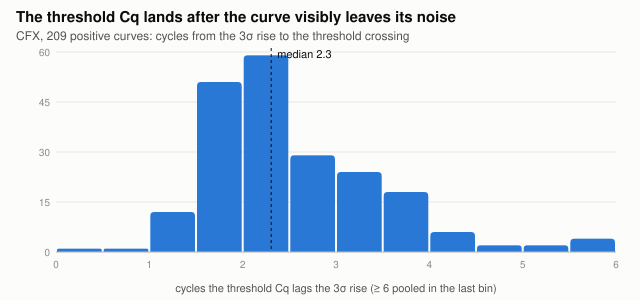
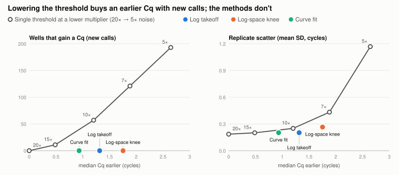
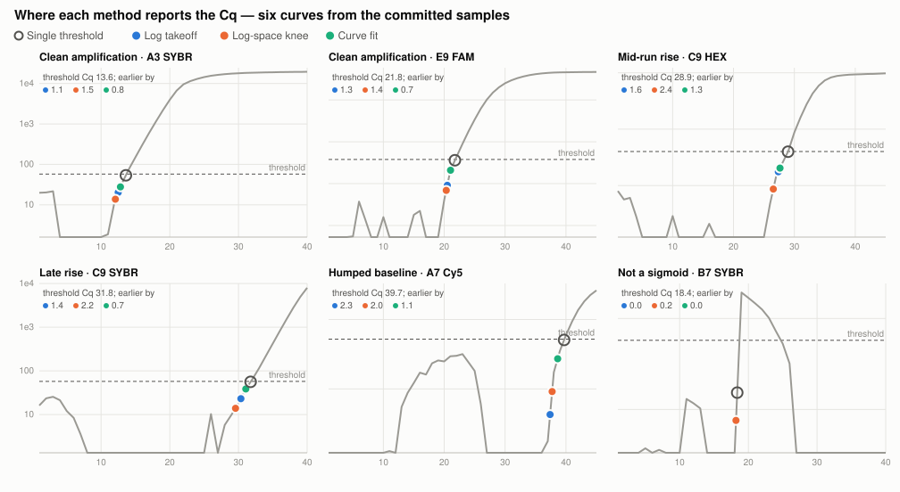
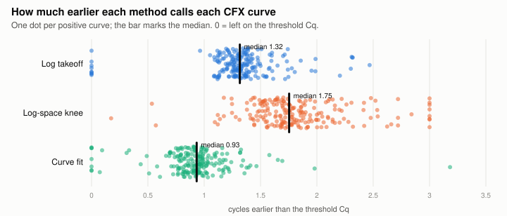

# Cq methods: calling the Cq earlier without new false positives

*A comparison report, October 2026. The methods themselves are specified in
[`threshold.md`](./threshold.md) §11, and the tuning record — every variant tried and why it was
dropped — is that doc's Appendix C. This report is the comparison in one place, with charts.*

## Summary

The app's Cq has reproduced CFX Maestro's default "Single Threshold" rule exactly, and on a clean CFX
curve that rule calls **a median 2.3 cycles after the curve visibly leaves its noise**. Three
alternative Cq methods now sit beside it in the Curves rail's Threshold section. Each re-reads a call
the threshold already made, and none can add one:

| Method | Calls CFX Cq earlier by (median) | Placed before the visible rise (CFX / Biomeme) | Replicate scatter, CFX (threshold: 0.185) | Wells that gain a Cq |
|---|---|---|---|---|
| Single threshold (default) | — | 0 / 0 | 0.185 | — |
| **Log takeoff** (recommended) | **1.32** cycles | **0 / 0** | **0.202** | **0** |
| Log-space knee | 1.75 cycles | 0 / 5 | 0.265 | 0 |
| Curve fit | 0.93 cycles | 0 / 8 | 0.202 | 0 |
| *for contrast:* threshold lowered to 10× noise | 1.20 cycles | — | 0.250 | **57** |

**Log takeoff is the recommended alternative.** It moves the Cq to the foot of the log-space rise
while keeping replicates nearly as tight as the threshold. The default stays the threshold crossing,
because that is the rule the instrument's own exported numbers are reproduced with.

## 1. The problem



*Figure 1. For each of the 209 positive curves in the CFX corpus: the cycles between the point where
the baseline-corrected curve last rises through 3σ of its own noise and the threshold crossing.*

The automatic threshold is 20× the median baseline noise of the dye's wells (`threshold.md` §5.2).
That level clears a flat well's jitter comfortably, but a clean exponential has already been rising
for a couple of cycles when it gets there. On a log axis the Cq ring sits well up the straight line
of the exponential rather than at its foot, so the Cq reads as late. The lag is consistent: 1.6
cycles at the 10th percentile, 3.8 at the 90th.

## 2. How CFX Maestro calls Cq

CFX Maestro offers two Cq determination modes:

- **Single Threshold** — the default. One threshold per fluorophore; Cq is where each baseline-
  corrected trace crosses it. This app reproduces it to ~1e-10 cycles given the instrument's own
  corrected curves (`threshold.md` §A.2).
- **Regression** — "applies a multivariable, nonlinear regression model to individual well traces and
  then uses this model to compute an optimal Cq value" ([lab SOP][sop]). The model is not published,
  and no run in hand was exported in this mode, so it can be approximated in spirit (the Curve fit
  method below) but not reproduced.

[sop]: https://borc.unl.edu/sites/unl.edu.cehs.biomedical-obesity-research-core/files/media/file/BORC%20SOP%20CFX%20RealtimePCR.pdf

## 3. Why not just lower the threshold?

Because the threshold has two jobs, and lowering it changes the wrong one. It decides **whether** a
well amplified, and it decides **where** the Cq is read. Lowering it moves the Cq earlier only by
calling more wells:

| Multiplier | CFX Cq earlier (median) | CFX wells that gain a Cq | Biomeme wells that gain a Cq |
|---|---|---|---|
| 20× (default) | — | — | — |
| 15× | 0.49 | 11 | 422 |
| 10× | 1.20 | 57 (+27%) | 1061 |
| 7× | 1.88 | 121 | 1591 |
| 5× | 2.65 | 193 | 2053 |

Most of the wells that gain a Cq are flat or drifting. At 10× they include a ROX well called at
cycle 2.1. So the methods keep the threshold's decision and change only the reading, under one
contract (`threshold.md` §11.2):

- **No threshold Cq ⇒ no Cq.** A method can never add a call, so it cannot add a false positive.
- **Never later than the threshold Cq**, and never before cycle 3.
- **Nothing upstream moves.** Baselines, noise estimates and thresholds are all still placed with the
  threshold Cq.



*Figure 2. CFX corpus. Grey: the single threshold at 20×, 15×, 10×, 7× and 5× noise. Coloured: the
three methods, all on the default 20× threshold. Left: every method sits on the zero line by
construction, while the lowered thresholds climb. Right: replicate scatter is the mean standard
deviation of Cq over the 11 replicate groups (technical triplets sharing run, sample, target, dye
and plate row). The grey line's scatter includes the wells it newly calls.*

The right panel is also an honest caveat. On *clean* replicates, a threshold lowered to 10× scatters
no more than the default (0.173 against 0.185). The cost of lowering the threshold is the calls it
adds, not its precision on wells that were already positive.

## 4. The methods

On a log axis an amplification curve is a flat floor, then the straight line of the exponential. The
**takeoff** is the corner between them, where the second derivative of log fluorescence peaks. For
`F = P + A·e^(b·c)` that peak is exactly where the exponential term equals the floor `P`. So each
method is, at heart, a choice of floor and a robust way of finding the corner:

| Method | How it finds the corner | Floor |
|---|---|---|
| **Log takeoff** | Fits a straight line to log RFU over the early exponential (from the 3σ rise up to 5× threshold), then solves for the corner analytically. Declines when the fitted per-cycle gain is outside 1.2–2.5 or the move would exceed 3 cycles. | 0.4 × threshold |
| **Log-space knee** | Walks back from the threshold crossing to the corner of a hinge fit, floor-then-line, searched over the 3 cycles before the crossing. Never before the curve last rose through a quarter of the threshold (or 3σ). | 0.25 × threshold |
| **Curve fit** | Fits a logistic curve by weighted Levenberg–Marquardt, then takes the log-space corner of the *fitted* curve. A poor or implausible fit fades back to the threshold Cq. | 0.6 × threshold |



*Figure 3. Six curves from runs committed in `samples/`, on a log axis (floored at half the curve's
noise, so the baseline reads as a floor). The grey ring is the threshold Cq; coloured dots are each
method's Cq. Top row and bottom left: clean rises, where all three methods land in a consistent order
on the straight line between the floor and the threshold. Bottom middle: a humped baseline the
threshold already called late, which every method still moves, by 1.1–2.3 cycles. Bottom right: a curve that
is not a sigmoid, where Log takeoff and Curve fit decline and Log-space knee barely moves.*

## 5. Results



*Figure 4. Every positive CFX curve, by how much earlier each method calls it. Dots at 0 are curves
the method left on the threshold Cq.*

Scored with `tools/cqeval.mjs` over two corpora: every CFX run in the lab repo and `samples/` (14
runs, 209 positive and 703 negative curves), and every Biomeme run in the lab repo (373 runs, 3004
positive and 3263 negative curves).

| | Log takeoff | Log-space knee | Curve fit |
|---|---|---|---|
| **CFX** — earlier by, median / p90 / max | 1.32 / 1.61 / 2.47 | 1.75 / 2.41 / 3.00 | 0.93 / 1.19 / 3.18 |
| CFX curves left unchanged | 9 | 0 | 7 |
| CFX curves placed before the visible rise | 0 | 0 | 0 |
| CFX replicate scatter (threshold 0.185) | 0.202 | 0.265 | 0.202 |
| **Biomeme** — earlier by, median / p90 / max | 0.00 / 1.92 / 3.00 | 2.33 / 3.00 / 3.00 | 0.00 / 1.25 / 4.48 |
| Biomeme curves left unchanged | 1560 | 25 | 1865 |
| Biomeme curves placed before the visible rise | 0 | 5 | 8 |
| Biomeme clean-replicate scatter (threshold 0.474) | 0.559 | 0.552 | 0.490 |
| Biomeme: device's own Cq minus this Cq, median (threshold alone: 1.08) | 2.27 | 2.98 | 1.88 |

How to read the rows:

- **Placed before the visible rise** — a Cq more than a cycle before the curve last rises through 3σ
  of its own noise. This is the count of Cqs pushed back too far.
- **Replicate scatter** — mean standard deviation of Cq over groups of positive wells sharing run,
  sample, target, dye and plate row. On Biomeme, "clean" keeps the 45 groups whose threshold Cqs
  already agree to within an SD of 1 cycle. The other 165 are mislabelled or genuinely different
  wells, and their scatter says nothing about the method.

## 6. What the experiments taught

Four algorithm families were built, each by a separate agent, and scored against the same harness.
The lessons that shaped the shipped methods:

1. **A second derivative read straight off the data is too noisy.** The knee is broad against
   one-cycle sampling, so noise picks which cycle peaks. Tight triplets scattered 0.4–0.9 cycles,
   against the threshold's 0.10. Every shipped method finds the corner by *fitting*.
2. **Levels must be shared by the dye, not set per well.** Each family's first version placed its
   floor at a multiple of the well's own noise. But replicate wells share a threshold, not a noise
   level, which varies up to 8× between them. Per-well floors roughly doubled the scatter (Curve fit
   0.418, Log-space knee 0.407). Re-expressed as fractions of the threshold, they came back to
   0.20–0.27.
3. **Soft gates beat hard ones.** A hard cutoff puts two near-identical replicates on opposite sides
   of it, one shifted by a cycle and one not. Curve fit's soft gates take its scatter from 0.257 to
   0.202.
4. **The literal takeoff point moves nothing on CFX.** The peak of the second derivative of log raw
   fluorescence, background included, falls *after* the threshold. A CFX background sits ~2000σ
   above zero, so the floor that matters is a noise-scale level, not the background.
5. **The lateness is a CFX problem.** On Biomeme files this app's threshold Cq is already a median
   1.08 cycles *earlier* than the device's own. That is why Log takeoff and Curve fit leave over
   half of Biomeme curves alone.

A fourth candidate, **exponential back-extrapolation** to a fixed fraction of the threshold
(LinRegPCR-style), was dropped. It reduced to a near-constant 2-cycle shift set by its cap, and it
scattered more than Log takeoff (0.296), which is the same idea solved for the analytic corner.

## 7. Recommendation

- **Use Log takeoff** when a CFX run's Cqs read late. It calls about 1.3 cycles earlier, never before
  the visible rise on either corpus, with replicate scatter within 0.02 cycles of the threshold's.
- **Log-space knee** is for calling as early as possible. Expect about 1.75 cycles earlier and
  somewhat more replicate scatter.
- **Curve fit** is the cautious choice, and the nearest thing here to CFX Maestro's Regression mode.
- **Leave the default** wherever a Cq must match CFX Maestro's own Single Threshold numbers.

The method is a per-run setting saved in the run's `zpcrweb.json`, so it travels with the file.
Under any method but the default, the chart's Cq rings are markers rather than drag handles.

## Reproducing this report

```sh
npx vite-node tools/cqeval.mjs --set cfx          # the CFX table
npx vite-node tools/cqeval.mjs --set biomeme      # the Biomeme table
npx vite-node tools/cqeval.mjs --set cfx --plots out/ --only changed   # contact sheets
```

The corpus is the lab repo (`~/lab/MolBioLab`, or `MOLBIOLAB`) plus `samples/`. Only the curves in
Figure 3 are drawn from individual runs, and all of those are committed in `samples/`; everything
else is aggregated. The lower-threshold rows come from `loadCorpus({ settingsPatch: {
thresholdMultiplier: k } })` (`tools/cqeval.md`). Every run here is scored at the default 20×
multiplier, which is why these figures can differ slightly from a run opened with a saved multiplier
of its own.
